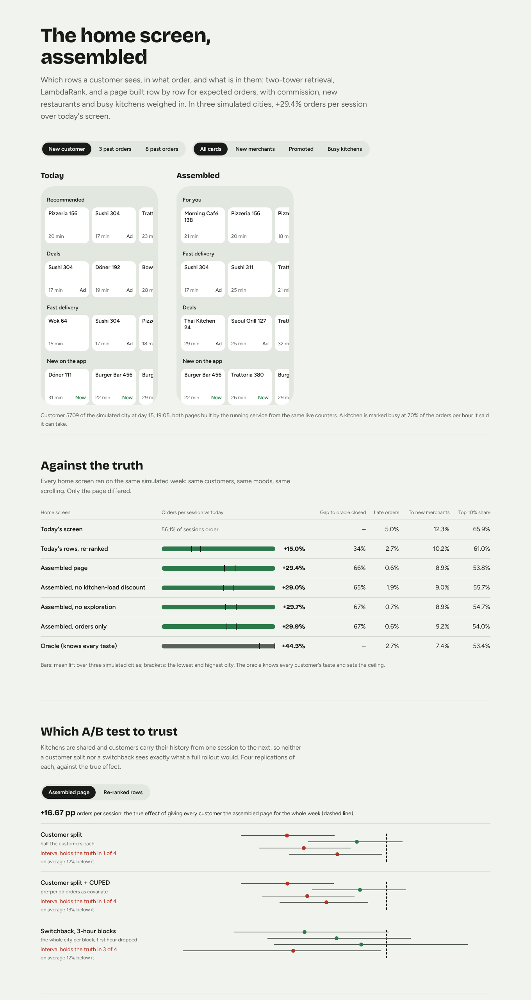

# food-homescreen-ranker

Home-screen ranking for a food delivery app, end to end: two-tower retrieval, LambdaRank with calibrated order
probabilities, a sequential model for the order-again row, cold-start exploration for new restaurants, and a page
assembler that builds the whole screen row by row while weighing orders, commission, new-restaurant exposure and
kitchen load. Every policy is scored against simulated customers whose tastes the models never see, and the A/B
designs are checked against the true effect, including the one that kitchen congestion hides from a customer split.



## Results

Three simulated cities (seeds 11, 23, 37), one week each after two weeks of logged history, then a held-out city
with other cuisines, more new restaurants and tighter kitchens, scored once.

<!-- results:start -->
| What | Result |
|---|---|
| Orders per session vs today's screen (3 simulated cities) | re-ranked rows +15.0%, **assembled page +29.4%** (range +26.3% to +31.1%); closes 66% of the gap to an oracle |
| Late orders (over 45 min) | today 5.0%, assembled 0.6%, assembled without the kitchen-load discount 1.9% |
| Orders to new merchants / on the top 10% of merchants | today 12.3% / 65.9%, assembled 8.9% / 53.8% |
| Retrieval: next orders in the two-tower's top 50 | 83% vs 78% for popularity; never-ordered merchants 28% vs 0% |
| Ranking: NDCG@8 on held-out days | LambdaRank 0.580, the page as served 0.501, popularity 0.458 |
| Order-again row: next-order recall@10 | GRU 47% vs counts 35%: the GRU ships in every city |
| A/B designs vs the true full-rollout effect (assembled page; re-ranked rows) | estimates land 13% low and 13% low with a customer split, 12% low and 19% low with a switchback; intervals hold the truth 1/4 and 2/4 (split, CUPED), 3/4 and 2/4 (switchback); CUPED narrows the split's interval by 2% |
| Serving (HTTP, one core) | p50 5.8 ms, p95 7.2 ms |
| Gate | page: **ships**, reranked: **ships** |
| Held-out city (scored once) | re-ranked +11.0%, assembled **+27.2%** orders per session |
<!-- results:end -->

The numbers come from `reports/*.json`; `python scripts/report.py` writes this table and the dashboard data.

## What the screen does

```
logged sessions ──► features.sql (DuckDB in dev, Spark nightly; online() at serving, all three tested equal)
                        │
    two-tower retrieval (in-batch negatives, logQ, merchant-ID dropout for cold start) ──► ~120 candidates
                        │
    LambdaRank on order > click > seen, calibrated to P(order)        GRU over the order sequence
                        │                                                   │ (order-again row)
                        ▼                                                   ▼
    page assembler: value = P(order) × (1 + commission weight) × kitchen-load discount + exploration bonus
                    rows placed greedily by marginal value, merchants deduplicated across rows,
                    guardrails for promoted and new merchants
                        │
    FastAPI: /v1/home, SageMaker /ping and /invocations, /metrics; falls back to today's page on any failure
```

The rows on today's screen come from a fixed template (order again, recommended, deals, fast, new, cuisine) filled
by a hand-weighted score. The re-ranked policy keeps that template and only sorts each row with the learned
ranker; the assembled page chooses which rows appear and in what order. The difference between the two is how
much of the gain comes from whole-page decisions rather than better scores.

## The simulated city

Truth lives in `config/world.toml` and nowhere else that serves: each customer has a hidden taste vector, price and
ETA sensitivity, novelty seeking and loyalty; each merchant has a hidden quality and a kitchen whose real capacity
differs from what the platform thinks. Customers look at rows with decaying attention and only a couple of cards
per row, click when a card is good enough, order when it is better still, and sometimes give up and search.
Kitchens slow down past 70% load, so a page that sends everyone to the same few kitchens makes its own food late.

The oracle policy reads the hidden tastes and kitchens, which gives each city a ceiling: the table reports how much
of the gap between today's screen and that ceiling each policy closes.

## Findings

- **Most of the gain is the page, not the score.** Sorting today's rows with the learned ranker gets about half of
  the lift; choosing the rows and their order gets the rest.
- **The kitchen-load discount is nearly free.** Orders barely move with or without it, and late orders fall by about
  two thirds, because it stops the page from sending the evening rush to kitchens that are already full.
- **Commission costs a little.** The commission term in the page value gives up under one percent of orders for two
  to five percent more commission per session, depending on the city. The weight is a business decision; it is in
  config.
- **Exploration does less than expected.** With a dedicated new-restaurant row and a guardrail already in place, the
  UCB bonus moves orders by less than a point either way and leaves the new-merchant share unchanged. It stays at a small
  weight because it costs little; it is the first thing to test again on real traffic.
- **New merchants lose share.** Today's fixed "new" row gives new restaurants more orders than the assembled page
  does. The page stays above the gate's floor, and concentration on the top 10% of merchants drops sharply, but
  this is the trade-off a launch review should look at first.
- **Neither A/B design sees the full rollout.** Against the true effect of giving everyone the new page for the whole
  week, a customer split and a switchback both land 12 to 19% low. The switchback drops the first hour of each block,
  so kitchens are not the cause; the likely one is that both designs blend each customer's week, and what the
  order-again row and novelty see next depends on what the customer was shown before. Both still put the lower
  bound well above zero, so the gate's ship decisions are right; the launch forecast should not be the A/B number.
  For the page, the switchback's wider interval holds the truth 3 of 4 times against 1 of 4 for the split.
- **CUPED barely helps here.** The two weeks of pre-period orders explain little of a customer's order rate in a week
  where the page changed, and the interval narrows by about 2%. The first CUPED version adjusted orders as if the
  metric were a sum and widened the interval instead; the analysis now linearises orders per session, and a test
  checks that it narrows the interval when the covariate is informative.
- **Spark and DuckDB disagreed on the first run.** A missing rating came from pandas as NaN; Spark kept it as a
  number while DuckDB read it as NULL. The parity test caught it; missing values now go to Spark as NULL with an
  explicit schema.

## Run it

```bash
pip install -e '.[dev]'
pytest -q                      # 23 tests on a small city
pytest -q -m spark             # Spark features against DuckDB
python scripts/evaluate.py     # three cities, every policy and ablation
python scripts/experiments.py  # customer split, CUPED, switchback against the true effect
python scripts/serve_bench.py  # HTTP latency and sample pages
python scripts/gate.py         # ship or hold, from the experiment and serving only
python scripts/report.py       # this table and web/public/data.json
cd web && npm ci && npm test && npm run build
```

`dags/home_ranker_daily.py` runs features, training, the offline evaluation and the bundle as an Airflow DAG;
the `Dockerfile` serves a bundle from `/opt/ml/model` on the SageMaker contract.

## Layout

```
config/          world (truth), platform settings, the held-out city and its lock
src/fhr/world    the simulated city and its customers
src/fhr/features features.sql and the serving path that must match it
src/fhr/models   two-tower, LambdaRank, GRU
src/fhr/policies today's screen, the re-ranked rows, the page assembler
src/fhr/evals    online metrics, the oracle, experiment designs
src/fhr/serve    bundle loading and the FastAPI app
scripts/         evaluation, experiments, gate, held-out run, report
web/             the dashboard (React, Framer Motion)
docs/            decisions and the held-out record
```

## Limits

The customers are simulated, so the absolute lift says how well the models recover the structure the simulator
puts in, not what a real city would show. What carries over is the method: logging only what was seen, point-in-time
features with one definition, comparing every policy on the same simulated week, reading guardrails beside the
headline metric, and choosing an experiment design that survives interference between customers.
